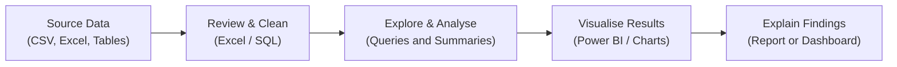

<div align="center">

<!-- HERO BANNER -->
<a href="https://aparnachakure.github.io/finance-tracker/">
  
</a>

<br/>

<!-- DYNAMIC TYPING HEADLINE ANIMATION -->
<a href="https://aparnachakure.github.io/finance-tracker/">
  
</a>

<br/><br/>

<!-- QUICK ACTION BADGES -->
[](https://aparnachakure.github.io/finance-tracker/)
[](https://linkedin.com/in/aparna-chakure)
[](mailto:aparnachakure@gmail.com)
[](mailto:aparnachakure@gmail.com)
[](mailto:aparnachakure@gmail.com)

<br/>

<!-- INTERACTIVE NAVIGATION BAR -->
<table>
  <tr>
    <td align="center"><b><a href="#-about-me">⚡ About</a></b></td>
    <td align="center"><b><a href="#-featured-projects">🚀 Projects</a></b></td>
    <td align="center"><b><a href="#-my-analytics-workflow">🧠 Workflow</a></b></td>
    <td align="center"><b><a href="#-technical-skills">🛠️ Skills</a></b></td>
    <td align="center"><b><a href="#-professional-experience">🏢 Experience</a></b></td>
    <td align="center"><b><a href="#-education">🎓 Education</a></b></td>
    <td align="center"><b><a href="#-lets-connect">📬 Contact</a></b></td>
  </tr>
</table>

</div>

---

### ⚡ About Me

> **IT graduate developing practical data analytics skills through hands-on projects using SQL, Excel, and Power BI.**

I’m based in Pune, India, and I’m building my career in data analytics by combining my IT background, previous experience in a technical support role, and practical portfolio projects. I enjoy working with data, organising information, exploring patterns, and presenting findings in a clear and useful way.

I’m currently strengthening my skills in **SQL, Excel, and Power BI** through structured learning and project practice. My project work gives me opportunities to practise data cleaning, analysis, reporting, and dashboard design.

#### 🎯 What I’m Working On
* **SQL:** Practising queries to retrieve, filter, combine, and analyse data.
* **Excel:** Organising datasets, using formulas, and preparing clear summaries and reports.
* **Power BI:** Learning to build reports and visualise key metrics.
* **Data Analysis Projects:** Applying what I learn to retail, healthcare operations, and personal finance datasets.
* **Continuous Learning:** Improving my analytical thinking and explaining project decisions clearly.

---

### 🚀 Featured Projects

These are **portfolio and learning projects** that demonstrate how I practise data analysis and build small, useful applications. They are not presented as commercial client deployments.

<table>
  <!-- PROJECT 1: FinPulse BI / Finance Tracker -->
  <tr>
    <td width="55%" valign="top">
      <h3>1. FinPulse — Personal Finance Tracker</h3>
      <b>Personal Finance • Data Visualisation • Web Application</b><br/>
      <a href="https://aparnachakure.github.io/finance-tracker/"><code>Open Live Project</code></a>
      <br/><br/>
      A personal finance web application designed to help users record transactions and understand their spending through summaries and charts:
      <ul>
        <li><b>Finance Summary:</b> Displays income, expenses, savings, and related totals based on the recorded transactions.</li>
        <li><b>Visual Reports:</b> Uses charts to present cash-flow trends and expense categories.</li>
        <li><b>Transaction Management:</b> Lets users organise and review their financial entries.</li>
        <li><b>CSV Export:</b> Includes an option to export data for further review in spreadsheet software.</li>
      </ul>
      <b>Tools used:</b> <code>HTML</code> • <code>CSS</code> • <code>JavaScript</code> • <code>Chart.js</code>
    </td>
    <td width="45%" align="center" valign="middle">
      <br/>
      <a href="https://aparnachakure.github.io/finance-tracker/">
        
      </a>
      <br/><br/>
      <a href="https://github.com/aparnachakure/finance-tracker">
        
      </a>
      <br/><br/>
      <sub>Interactive personal finance web app</sub>
    </td>
  </tr>

  <!-- PROJECT 2: Retail Sales Analytics -->
  <tr>
    <td width="55%" valign="top">
      <h3>2. Retail & Superstore Sales Analytics</h3>
      <b>Sales Analysis • Reporting • Dashboard Practice</b><br/><br/>
      A portfolio case study focused on exploring retail sales data and presenting useful business summaries:
      <ul>
        <li>Explore sales and profit across product categories, regions, and customer segments.</li>
        <li>Practise preparing data and identifying patterns in sales performance.</li>
        <li>Present key metrics and findings in a dashboard-style report.</li>
      </ul>
      <b>Tools:</b> <code>Excel</code> • <code>SQL</code> • <code>Power BI</code> (where used in the project)
    </td>
    <td width="45%" align="center" valign="middle">
      <br/>
      
      <br/><br/>
      
      <br/><br/>
      <sub>Retail sales and profit analysis</sub>
    </td>
  </tr>

  <!-- PROJECT 3: Healthcare Operations Analytics -->
  <tr>
    <td width="55%" valign="top">
      <h3>3. Healthcare Operations Analytics</h3>
      <b>Healthcare Data • Data Cleaning • Operational Reporting</b><br/><br/>
      A learning project using healthcare operations data to practise organising records and exploring operational trends:
      <ul>
        <li>Prepare and review healthcare-related data for analysis.</li>
        <li>Use queries and summaries to explore operational measures and patterns.</li>
        <li>Present findings through tables, charts, and dashboard-style reporting.</li>
      </ul>
      <b>Tools:</b> <code>SQL</code> • <code>Excel</code> • <code>Power BI</code> • <code>Python/Pandas</code> (where included in the project)
    </td>
    <td width="45%" align="center" valign="middle">
      <br/>
      
      <br/><br/>
      
      <br/><br/>
      <sub>Healthcare operations data exploration</sub>
    </td>
  </tr>
</table>

---

### 🧠 My Analytics Workflow

For each project, I aim to follow a clear and repeatable process: understand the dataset, clean and organise the data, analyse it, and communicate the main findings.



#### What I Practise
* **Data Quality:** Checking missing values, duplicates, and inconsistent entries.
* **Data Preparation:** Organising columns and formats before analysis.
* **Analysis:** Using queries, formulas, and summaries to answer practical questions.
* **Visualisation:** Choosing charts and metrics that make results easier to understand.
* **Communication:** Writing down what the results show and what could be explored next.

---

### 🛠️ Technical Skills

<table>
  <tr>
    <td width="28%"><strong>🗄️ SQL & Databases</strong></td>
    <td><code>SQL</code> • <code>MySQL</code> • <code>Filtering and Sorting</code> • <code>Joins</code> • <code>Aggregations</code> (based on current practice)</td>
  </tr>
  <tr>
    <td width="28%"><strong>📊 Reporting & Visualisation</strong></td>
    <td><code>Microsoft Excel</code> • <code>Power BI</code> • <code>Charts</code> • <code>Dashboard Practice</code></td>
  </tr>
  <tr>
    <td width="28%"><strong>🧹 Data Preparation</strong></td>
    <td><code>Data Cleaning</code> • <code>Data Validation</code> • <code>Data Organisation</code> • <code>Reporting</code></td>
  </tr>
  <tr>
    <td width="28%"><strong>🌐 Web Project Tools</strong></td>
    <td><code>HTML</code> • <code>CSS</code> • <code>JavaScript</code> • <code>Chart.js</code> (used in personal web projects)</td>
  </tr>
  <tr>
    <td width="28%"><strong>🛠️ Tools</strong></td>
    <td><code>Git</code> • <code>GitHub</code> • <code>VS Code</code> • <code>MySQL Workbench</code></td>
  </tr>
</table>

---

### 🏢 Professional Experience

#### **System Engineer — Infosys**
*May 2024 – May 2025 | Mysore, India*

* Worked in a technical support project environment.
* Used SQL for data-related tasks, including working with tables, combining data, and supporting data cleaning activities.
* Developed experience working with technical processes, structured information, and issue resolution.

#### **Admission Counsellor / Operations — Admissions Made Easy**
*July 2022 – June 2024 | Latur, India*

* Supported admission-related operations and communication with students.
* Worked with student information and records, helping keep information organised and up to date.
* Built transferable skills in communication, coordination, and handling structured information.

#### **Data Analytics Learning**
*NIIT — Data Analyst Training | Remote*

* Currently developing practical skills in SQL, Excel, Power BI, and data analysis through coursework and projects.
* Applying learning through portfolio projects to strengthen analysis, reporting, and visualisation skills.

---

### 🎓 Education

* **Bachelor of Technology (B.Tech) — Information Technology**  
  *Dr. Babasaheb Ambedkar Technological University (DBATU)*  
  *Graduated: 2022 • **CGPA: 8.3 / 10.0***

---

### 📬 Let's Connect

I’m open to **entry-level Data Analyst and related analytics opportunities** where I can apply my current skills, keep learning, and contribute to a team.

<div align="center">

[](mailto:aparnachakure@gmail.com)
[](https://linkedin.com/in/aparna-chakure)
[](https://aparnachakure.github.io/finance-tracker/)

<br/>

**Contact:** `aparnachakure@gmail.com` • Pune, Maharashtra, India

<br/>

```
╔══════════════════════════════════════════════════════════════════════════════════╗
║  Learning through projects • Building practical data analytics skills            ║
║  © 2026 Aparna Chakure                                                          ║
╚══════════════════════════════════════════════════════════════════════════════════╝
```

</div>


