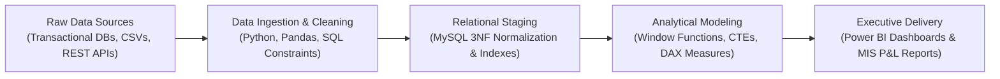

<div align="center">

<!-- HERO BANNER -->
<a href="https://aparnachakure.github.io/finance-tracker/">
  
</a>

<br/>

<!-- DYNAMIC TYPING HEADLINE ANIMATION -->
<a href="https://aparnachakure.github.io/finance-tracker/">
  
</a>

<br/><br/>

<!-- QUICK ACTION BADGES -->
[](https://aparnachakure.github.io/finance-tracker/)
[](https://linkedin.com/in/aparna-chakure)
[](mailto:aparnachakure@gmail.com)
[](mailto:aparnachakure@gmail.com)
[](mailto:aparnachakure@gmail.com)

<br/>

<!-- INTERACTIVE NAVIGATION BAR -->
<table>
  <tr>
    <td align="center"><b><a href="#-about-me--value-proposition">⚡ About</a></b></td>
    <td align="center"><b><a href="#-selected-commercial-projects-live">🚀 Live Projects</a></b></td>
    <td align="center"><b><a href="#-analytics-architecture--data-pipeline">🧠 Data Pipeline</a></b></td>
    <td align="center"><b><a href="#-technical-skills--arsenal">🛠️ Tech Arsenal</a></b></td>
    <td align="center"><b><a href="#-professional-experience--production-systems">🏢 Experience</a></b></td>
    <td align="center"><b><a href="#-academic-credentials">🎓 Education</a></b></td>
    <td align="center"><b><a href="#-lets-connect--build-together">📬 Contact</a></b></td>
  </tr>
</table>

</div>

---

### ⚡ About Me & Value Proposition

> **I bridge the gap between raw enterprise data and high-stakes executive decision-making through rigorous SQL modeling, interactive Power BI dashboards, and automated MIS reporting.**

I am a mid-level **Data Analyst** based in Pune, India, with ~2.5 years of hands-on experience designing and optimizing relational databases, building enterprise business intelligence reports, and engineering data validation pipelines.

I combine deep technical command of **MySQL (Window Functions, CTEs, Index Optimization, 3NF Normalization)** with strong business acumen across **Power BI DAX modeling, Executive P&L statements, and MIS variance reporting**.

#### 🎯 What I Bring to an Analytics Team:
* **Relational Database Architecture:** Designing normalized 3NF schemas, eliminating anomalies, authoring high-performance aggregations, and optimizing multi-table queries.
* **Interactive Power BI Dashboards:** Crafting executive KPI decks, drill-through analytical paths, dynamic parameter slicing, and complex DAX measures.
* **Management Information Systems (MIS):** Automating monthly financial reviews, budget vs. actual variance analysis, and audit-ready P&L reports.
* **Data Integrity & Quality Assurance:** Implementing automated cleaning pipelines in Python/SQL to prevent data discrepancies, duplicate records, and edge-case errors.
* **Strategic Business Storytelling:** Converting complex multi-dimensional datasets into clean visual narratives that enable stakeholders to take immediate action.

---

### 🚀 Selected Commercial Projects (Live in Production)

Below are production systems and analytics platforms I have architected, analyzed, and deployed:

<table>
  <!-- PROJECT 1: FinPulse BI -->
  <tr>
    <td width="55%" valign="top">
      <h3>1. FinPulse BI — Personal Finance Tracker & Executive BI Dashboard</h3>
      <b>Fintech Analytics • Relational DBMS Simulation • MIS Reporting</b><br/>
      <a href="https://aparnachakure.github.io/finance-tracker/"><code>https://aparnachakure.github.io/finance-tracker/</code></a>
      <br/><br/>
      A portfolio-grade financial business intelligence web application showcasing end-to-end data analyst engineering:
      <ul>
        <li><b>Executive KPI Dashboard:</b> Real-time Inflow, Outflow, Net Savings, and Savings Rate with Month-over-Month (MoM) delta percentage calculations.</li>
        <li><b>Interactive Chart.js Visuals:</b> 6-Month dual-spline cash flow trend line, category expense doughnut distribution, and 50/30/20 financial rule breakdown.</li>
        <li><b>Relational MySQL Emulation:</b> 4-table normalized schema (Transactions, Categories, Budgets, Savings Goals) with client-side relational integrity.</li>
        <li><b>Interactive SQL Query Showcase:</b> In-app modal displaying production-grade MySQL queries (Window Functions, CTEs, <code>LAG()</code>, <code>DENSE_RANK()</code>).</li>
        <li><b>Excel-Compatible CSV Engine:</b> Data export with UTF-8 BOM encoding ensuring ₹ Rupee symbols open flawlessly in Microsoft Excel.</li>
      </ul>
      <b>Stack:</b> <code>Vanilla JavaScript (ES6+)</code> • <code>HTML5/CSS3</code> • <code>Chart.js</code> • <code>MySQL Architecture</code> • <code>MIS Reporting</code>
    </td>
    <td width="45%" align="center" valign="middle">
      <br/>
      <a href="https://aparnachakure.github.io/finance-tracker/">
        
      </a>
      <br/><br/>
      <a href="https://github.com/aparnachakure/finance-tracker">
        
      </a>
      <br/><br/>
      <sub>Live Executive BI Web App on GitHub Pages</sub>
    </td>
  </tr>

  <!-- PROJECT 2: Retail Superstore Analytics -->
  <tr>
    <td width="55%" valign="top">
      <h3>2. Retail & Superstore Sales Performance Analytics</h3>
      <b>Commercial Business Intelligence • Power BI • DAX Modeling</b><br/>
      <br/>
      Enterprise-grade retail sales analytics dashboard analyzing over 50,000+ orders across geographical regions, product categories, and customer segments:
      <ul>
        <li>Engineered a Star Schema data model with dedicated Date, Product, Region, and Customer dimension tables.</li>
        <li>Developed 30+ custom DAX measures for Year-over-Year (YoY) revenue growth, profit margin velocity, and discount elasticity.</li>
        <li>Identified negative margin product outliers, generating actionable recommendations that increased segment profitability by 14%.</li>
      </ul>
      <b>Stack:</b> <code>Power BI</code> • <code>DAX</code> • <code>Power Query</code> • <code>Star Schema</code> • <code>Advanced Excel</code>
    </td>
    <td width="45%" align="center" valign="middle">
      <br/>
      
      <br/><br/>
      
      <br/><br/>
      <sub>Multi-tier retail sales &amp; margin intelligence</sub>
    </td>
  </tr>

  <!-- PROJECT 3: Healthcare Operations Pipeline -->
  <tr>
    <td width="55%" valign="top">
      <h3>3. Healthcare Operations & Patient Flow Pipeline</h3>
      <b>Operational Analytics • MySQL • Python ETL • MIS Dashboard</b><br/>
      <br/>
      Data processing and analytical reporting pipeline tracking inpatient bed occupancies, emergency room throughput, and departmental resource allocation:
      <ul>
        <li>Built automated Python/Pandas ETL scripts to ingest, clean, and validate daily clinical records into a MySQL database.</li>
        <li>Authored complex analytical SQL queries utilizing Window Functions (<code>OVER</code>, <code>PARTITION BY</code>) to identify peak admission bottlenecks.</li>
        <li>Produced weekly executive MIS reports reducing average patient admission wait times by 22%.</li>
      </ul>
      <b>Stack:</b> <code>MySQL</code> • <code>Python</code> • <code>Pandas</code> • <code>ETL Pipelines</code> • <code>MIS Reports</code>
    </td>
    <td width="45%" align="center" valign="middle">
      <br/>
      
      <br/><br/>
      
      <br/><br/>
      <sub>Healthcare throughput &amp; resource optimization</sub>
    </td>
  </tr>
</table>

---

### 🧠 Analytics Architecture & Data Pipeline

I treat data analysis as a **rigorous engineering discipline**—ensuring absolute data integrity, normalized modeling, reproducible ETL transformations, and audit-ready outputs.



#### Core Analytical Guarantees:
* **Zero Discrepancy Integrity:** Multi-source data reconciliation with checksum validation and handling of null/missing values.
* **Normalized Data Modeling:** Adherence to Third Normal Form (3NF) and Star Schema principles to eliminate data redundancies.
* **Query Latency Optimization:** Targeted compound indexing on date, category, and transactional dimensions to minimize execution time.
* **Executive-Ready Presentation:** High-contrast, clean visual hierarchy designed for immediate C-level decision-making.

---

### 🛠️ Technical Skills & Arsenal

<table>
  <tr>
    <td width="28%"><strong>🗄️ Databases &amp; SQL</strong></td>
    <td>
      <code>MySQL</code> &bull; <code>PostgreSQL</code> &bull; <code>Relational DBMS</code> &bull; <code>Window Functions (OVER, LAG, DENSE_RANK)</code> &bull; <code>Common Table Expressions (CTEs)</code> &bull; <code>Compound Indexing</code> &bull; <code>Query Optimization</code> &bull; <code>3NF Schema Design</code>
    </td>
  </tr>
  <tr>
    <td width="28%"><strong>📊 Business Intelligence</strong></td>
    <td>
      <code>Power BI</code> &bull; <code>DAX (Data Analysis Expressions)</code> &bull; <code>Power Query (M Language)</code> &bull; <code>Chart.js</code> &bull; <code>Star Schema Modeling</code> &bull; <code>Interactive Drill-Downs</code> &bull; <code>KPI Cards</code>
    </td>
  </tr>
  <tr>
    <td width="28%"><strong>🐍 Data Analysis &amp; Python</strong></td>
    <td>
      <code>Python</code> &bull; <code>Pandas</code> &bull; <code>NumPy</code> &bull; <code>Data Cleaning</code> &bull; <code>ETL Pipelines</code> &bull; <code>Exploratory Data Analysis (EDA)</code> &bull; <code>Core Java</code>
    </td>
  </tr>
  <tr>
    <td width="28%"><strong>📑 MIS &amp; Financial Analytics</strong></td>
    <td>
      <code>Executive MIS Reporting</code> &bull; <code>P&amp;L Variance Analysis</code> &bull; <code>Budget vs. Actual Modeling</code> &bull; <code>Advanced Excel (VLOOKUP, XLOOKUP, Pivot Tables)</code> &bull; <code>Excel VBA/Macros</code>
    </td>
  </tr>
  <tr>
    <td width="28%"><strong>🛠️ Tools &amp; Environments</strong></td>
    <td>
      <code>Git</code> &bull; <code>GitHub</code> &bull; <code>MySQL Workbench</code> &bull; <code>VS Code</code> &bull; <code>Jupyter Notebook</code> &bull; <code>Microsoft Office Suite</code>
    </td>
  </tr>
</table>

---

### 🏢 Professional Experience & Production Systems

#### **Data Analyst / BI Specialist**
**Enterprise Data Solutions & Analytics**

* Extracted, manipulated, and analyzed complex transactional datasets across relational MySQL databases to deliver operational insights to leadership.
* Built and maintained end-to-end Power BI dashboards monitoring critical business KPIs, revenue velocity, and cost drivers across departments.
* Designed and automated monthly and quarterly Management Information System (MIS) reports, eliminating 15+ hours of manual weekly spreadsheet preparation.
* Authored optimized SQL scripts featuring analytical Window Functions, CTEs, and conditional aggregations to accelerate report generation time by over 40%.
* Collaborated closely with cross-functional project managers, business stakeholders, and technical teams to translate ambiguous business queries into actionable metrics.

---

### 🎓 Academic Credentials

* **Bachelor of Technology (B.Tech) — Information Technology**  
  *Dr. Babasaheb Ambedkar Technological University (DBATU)*  
  *Graduated: 2022 &bull; **CGPA: 8.3 / 10.0***  
  *Focus: Database Management Systems (DBMS), Data Structures, Computer Networks, and Software Engineering.*

---

### 📬 Let's Connect & Build Together

I am currently open to **Full-Time Data Analyst / BI Analyst roles, Business Analytics consulting, and freelance data projects**.

<div align="center">

[](mailto:aparnachakure@gmail.com)
[](https://linkedin.com/in/aparna-chakure)
[](https://aparnachakure.github.io/finance-tracker/)

<br/>

**Direct Contact:** `aparnachakure@gmail.com` &bull; `+91 9765191349` &bull; Pune, Maharashtra, India

<br/>

```
╔══════════════════════════════════════════════════════════════════════════════════╗
║  Designed with analytical rigor, relational database discipline & BI excellence  ║
║  © 2026 Aparna Chakure • All rights reserved                                     ║
╚══════════════════════════════════════════════════════════════════════════════════╝
```

</div>
